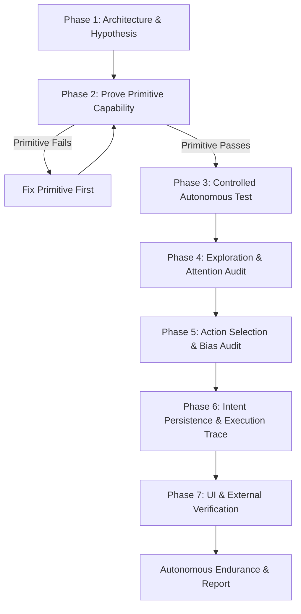

# Autonomous Behavior Debugger

The governing principle of this skill is:
> **Diagnose from observed behavior, not implementation intent.**

Never accept code existence, tool registration, prompt phrasing, API endpoints, unit tests, or log messages as proof that an autonomous feature works. An autonomous feature is only working when the AI independently, correctly, and reliably exhibits the behavior in the user-facing product.

---

## The 5 Levels of Autonomous Reality

Always separate these five levels when investigating an autonomous behavior:

1. **Capability**: Can the system physically perform the action when explicitly commanded?
2. **Availability**: Does the autonomous agent know the action is available in its operational context?
3. **Consideration**: Does the agent naturally evaluate the candidate opportunity and action?
4. **Initiative**: Does the agent independently choose the action when appropriate without forced prompts?
5. **Execution & Verification**: Does the decision successfully translate into state persistence, external action, and real user-visible representation?

Do not collapse these into a single "working/broken" judgment. A failure at Level 3 requires a completely different remedy than a failure at Level 1 or Level 5.

---

## The 14-Step Autonomous Behavior Chain

Trace every investigated behavior through this end-to-end chain to find the **first failing transition**:

```text
1. Opportunity / Stimulus
   ↓
2. Discovery
   ↓
3. Observation
   ↓
4. Attention
   ↓
5. Consideration
   ↓
6. Decision
   ↓
7. Intent
   ↓
8. Scheduling / Action Selection
   ↓
9. Tool Invocation
   ↓
10. Execution
   ↓
11. External Service / API Result
   ↓
12. State Update
   ↓
13. Feedback to Agent
   ↓
14. User-Interface Representation & Real-World Verification
```

### Transition Rule
- Pinpoint the exact transition where reality diverges from expectation.
- If `Discovery` passes, `Observation` passes, but `Attention` fails: do **not** touch the tool execution or API layer. Focus on attention allocation and ingestion.
- If `Decision` passes and `Intent` is formed, but `Tool Invocation` does not occur: focus on intent serialization, worker pickup, or scheduler dispatch.

For detailed diagnostic questions and evidence queries per stage, consult [`references/behavior-chain-and-evidence-matrix.md`](references/behavior-chain-and-evidence-matrix.md).

---

## Required 7-Phase Debugging Workflow

When this skill is activated, do not merely produce an analytical plan. If you have environment access (code, terminal, logs, database, browser, test harness), **execute the investigation, apply repairs, and verify results.**



### Phase 1 — Reconstruct Architecture & Form Testable Hypothesis
Before modifying anything, map how the behavior travels through the running system:
- Source code, system prompts, action/tool definitions, schema types.
- Model context construction (what is actually injected into runtime prompts vs what exists in DB).
- Schedulers, watchers, agenda queues, background workers, event loops.
- Storage records, transaction boundaries, state machines.
- Connector/API execution envelopes, credentials, policy firewalls.
- Frontend feeds, live streams, UI state stores.

Formulate a testable hypothesis of how the target behavior is intended to flow and where the break is likely occurring.

### Phase 2 — Prove Primitive Capability (Commanded Execution)
Before testing autonomous judgment, verify whether the system can physically execute the action when explicitly commanded:
- Run a targeted script, harness test, or explicit prompt commanding the single primitive (e.g., explicit repost of post ID `X` or quote post with commentary `Y`).
- Trace: `Command → Action Creation → Tool/API Call → API Response → Database Record → UI Store → External Platform`.
- If the primitive fails: **Stop.** Debug and repair the underlying execution/API/schema bug first before analyzing model cognition.

### Phase 3 — Controlled Autonomous Decision Test
Once the primitive is proven, test autonomous choice in a controlled environment:
- Present a curated test scenario with multiple distinct candidates:
  - 1 post clearly suitable for reposting (amplification without commentary needed).
  - 1 post clearly suitable for quote-posting (compelling point where adding perspective adds value).
  - 1 post suitable for replying (direct question or conversational hook).
  - 1 post suitable for liking (brief acknowledgment).
  - Multiple posts that should be ignored (`NO_OP` / filtered).
- **Do not instruct the agent which action to take.**
- Observe whether it:
  1. Ingests all candidates into decision context.
  2. Allocates attention to them.
  3. Recognizes all available affordances (repost, quote, reply, like, ignore).
  4. Generates an authentic intention matching the candidate's character.
  5. Dispatches the action into execution.

### Phase 4 — Exploration & Attention Lifecycle Investigation
Treat background exploration and attention as first-class autonomous behaviors:
- Trace the lifecycle of findings/leads:
  - Who discovers candidates? In what DB table/queue are they stored?
  - What wakes the deliberation process? How often does it run?
  - Is exploration starved by higher-priority tasks or infinite loops?
  - Do findings sit in "ready" state indefinitely without a consumer?
  - Is "balanced" exploration backed by real execution time and budget?
  - Are cooldowns, stale-state rules, deduplication, or over-aggressive filters silently dropping candidates?
- Measure actual execution times and loop frequencies rather than relying on config labels.

For specific audit checklists, consult [`references/exploration-and-action-selection-audit.md`](references/exploration-and-action-selection-audit.md).

### Phase 5 — Action-Selection & Cognitive Bias Investigation
If the agent considers candidates but consistently avoids specific actions (e.g., replies often, but never quotes or reposts):
- Inspect structural biases in:
  - **Tool descriptions & docstrings**: Are quotes/reposts described with restrictive warnings, extreme thresholds, or vague utility?
  - **Prompt instructions**: Are there subtle instructions penalizing amplification or overemphasizing conversational replies?
  - **Few-shot examples**: Do all examples demonstrate replies and original posts while omitting quotes/reposts?
  - **Ranking / scoring heuristics**: Are threshold scores for quote/repost mathematically unreachable compared to reply/like?
  - **Action order**: Is repost/quote buried at the end of schemas or overshadowed by greedy early matches?
- Eliminate artificial barriers to allow authentic, balanced autonomous selection.

### Phase 6 — Intent Persistence & Execution Boundary
Ensure that once a decision is made, the intention does not disappear:
- Trace serialization of the decision object across process boundaries.
- Inspect task queues, worker pickup, lease timeouts, and agent-cycle transitions.
- Check idempotency keys, target ID mapping, author account context, and payload builders.
- Verify error handling: ensure unhandled API warnings or transient network glitches do not silently drop intentions without retry or logging.

### Phase 7 — User-Facing UI & External Verification
Never stop at a `200 OK` or background log:
- Inspect the user-facing product UI (Live activity stream, notification feed, agent history).
- Verify the external social account/platform or mock connector state.
- Ensure the action displays with full fidelity (correct author, parent post preview, commentary text, media attachments).
- If backend succeeded but UI does not show it, the feature is still broken.

---

## Meaningful Implementation Freedom & Architectural Repairs

When evidence locates the root cause, you are authorized and expected to repair the implementation. Do not limit repairs to prompt tweaks when the code or architecture is broken.

### Scope of Allowed Repairs
- **Prompts & Context Construction**: Correcting system instructions, few-shot examples, tool schemas, and cognition context builders.
- **Autonomous Loops & Scheduling**: Fixing worker wakeups, scheduler frequencies, agenda prioritization, attention budgets.
- **State & Queue Machines**: Fixing queue consumers, finding transition states, task dispatchers, retry policies.
- **Tools & API Connectors**: Fixing payload formatting, parameter schemas, credential binding, response handlers.
- **UI & Telemetry**: Fixing event emissions, live feed rendering, and user-facing status indicators.

### Architectural Rules
- **Prefer the smallest architecturally correct solution.**
- **Do not preserve faulty architecture** or layer patches over broken abstractions just because they exist.
- **Clean up obsolete speculative patches** left by previous debugging attempts that did not solve the root cause.
- **Never game tests** by hardcoding quotas (e.g. forcing a repost every 3 cycles) unless that is the genuine product design.

---

## Dynamic Instrumentation

When existing logs lack sufficient visibility into intermediate transitions, inject structured instrumentation before debugging.

### Recommended Event Types
```json
{"event": "opportunity_discovered", "candidate_id": "...", "source": "exploration"}
{"event": "observation_ingested", "candidate_id": "...", "context_tokens": 120}
{"event": "attention_allocated", "candidate_id": "...", "weight": 0.85}
{"event": "finding_deliberated", "candidate_id": "...", "action_options": ["repost", "quote", "reply", "noop"]}
{"event": "action_candidate_scored", "candidate_id": "...", "action": "quote", "score": 0.92, "threshold": 0.70}
{"event": "action_selected", "candidate_id": "...", "action": "quote", "reason": "Adds key context"}
{"event": "intent_dispatched", "intent_id": "...", "action": "quote", "target_id": "..."}
{"event": "tool_executed", "tool": "create_quote_post", "status": "success", "external_id": "..."}
{"event": "ui_state_updated", "event_id": "...", "visible_in_feed": true}
```

Instrument missing transitions, run the reproduction, capture the trace, and locate the failure point.

---

## Iterative Scientific Debugging Loop

Follow this strict cycle:

```text
1. Reproduce failure with concrete stimulus
2. Check Behavior Chain → Identify first FAIL or UNKNOWN transition
3. Gather hard runtime evidence (logs, DB records, traces)
4. Form minimal testable hypothesis
5. Implement architectural / code / prompt fix
6. Re-run Controlled Test (Phase 3)
7. Inspect resulting behavior across the full chain
8. Re-run Autonomous Endurance Test (Phase 8)
9. Verify UI and external platform state
10. Run regression test suite
```

---

## Autonomous Endurance Testing

Controlled tests prove the AI *can* make the decision. Autonomous endurance tests prove it *reliably* behaves correctly in the wild.

Allow the system to run naturally over multiple cycles without forced prompts:
- Does it explore without manual triggers?
- Does it notice incoming opportunities?
- Does it balance likes, replies, quotes, reposts, original posts, and `NO_OP`s according to its authentic persona?
- Does it maintain its identity without spamming or repetitive loops?
- Does behavior persist across agent restarts and cycle boundaries?

---

## Anti-Patterns to Actively Reject

Reject these common engineering and agentic pitfalls:
- ❌ **Implementation-Existence Fallacy**: Assuming that because a function, tool, or prompt exists, the feature works.
- ❌ **Prompt-Only Debugging**: Blindly adding sentences to system prompts when the context builder, queue, or scheduler is dropping data.
- ❌ **First-Fix Stopping**: Stopping after fixing one bug without verifying the entire end-to-end chain.
- ❌ **Unit-Test Substitution**: Treating a green mock test as proof of real autonomous product behavior.
- ❌ **Forced-Success Testing**: Directing the agent to repost and declaring autonomous initiative working.
- ❌ **Quota Gaming**: Adding artificial counter loops to satisfy a test rather than fixing natural decision heuristics.
- ❌ **Log-Only Success**: Declaring victory on HTTP 200 without checking the database, UI feed, and user experience.
- ❌ **Endless Analysis**: Writing massive diagnostic reports without writing code, running tests, or fixing bugs when tools permit.

For recovery strategies against these anti-patterns, see [`references/anti-patterns-and-verification.md`](references/anti-patterns-and-verification.md).

---

## Standard Evidence Table & Final Report

Maintain an evidence table during every investigation and include it in your final report:

### Evidence Table Format
| Stage | Status | Evidence / Observation |
| :--- | :--- | :--- |
| 1. Opportunity | PASS | Post `12345` fetched from feed |
| 2. Discovery | PASS | Finding created in `findings` table |
| 3. Observation | PASS | Injected into deliberation prompt context |
| 4. Attention | PASS | Selected in top-3 candidates for review |
| 5. Consideration | FAIL | Model considered reply and like only; quote omitted from option set |
| 6. Decision | NOT TESTED | Blocked by Stage 5 |
| 7. Intent | NOT TESTED | Blocked upstream |
| 8. Tool Invocation | NOT TESTED | Blocked upstream |
| 9. Execution | NOT TESTED | Blocked upstream |
| 10. UI Verification | NOT TESTED | Blocked upstream |

### Final Report Requirements
Every debugging session must conclude with the formal report format documented in [`references/final-report-template.md`](references/final-report-template.md), covering:
1. Target Behavior
2. Reproduction Method
3. First Failing Transition
4. Root Cause (supported by evidence)
5. Changes Implemented
6. Controlled Test Results
7. Autonomous Endurance Results
8. UI & External Verification
9. Regression Checks
10. Remaining Concerns & Confidence Level
