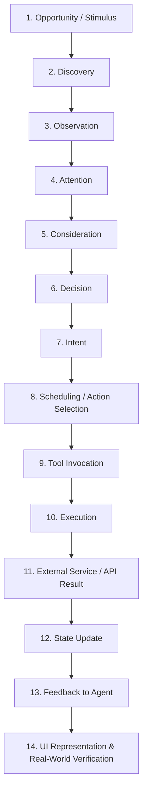

# Autonomous Behavior Chain & Evidence Matrix

This reference details each of the 14 transitions in the autonomous behavior execution chain. For every stage, it provides the core question, diagnostic queries/code locations, pass/fail indicators, and transition verification steps.

---

## The 14-Stage Behavior Transition Breakdown

---

### Stage 1: Opportunity / Stimulus
- **Core Question**: Does an eligible stimulus (e.g. social post, notification, timer, webhook, feed item) exist in the external environment or mock dataset?
- **Diagnostic Checks**:
  - Are feed fetchers polling the target source?
  - Are webhook endpoints receiving payloads?
  - Is test scenario data loaded into the target feed with valid timestamps and IDs?
- **PASS Criteria**: The external or incoming event payload is valid and accessible to the ingestion system.
- **FAIL Criteria**: No data received; polling error; invalid credentials on external API; empty mock feed.

---

### Stage 2: Discovery
- **Core Question**: Does the system discover the raw opportunity and record it internally?
- **Diagnostic Checks**:
  - Is the finding or raw event written to the database/queue (e.g. `findings`, `leads`, `events`, `mirrors`)?
  - Are deduplication or unique index constraints prematurely discarding new posts?
  - Are pre-filtering rules (e.g., language filters, spam detectors, age thresholds) rejecting the item?
- **PASS Criteria**: A persistent record of the opportunity exists in raw storage with an initial status (e.g. `NEW`, `READY`, `UNPROCESSED`).
- **FAIL Criteria**: Ingestion dropped the event silently; deduplication collided; ingestion worker threw unhandled exception.

---

### Stage 3: Observation
- **Core Question**: Does the candidate data reach the agent's actual model context in clean, usable form?
- **Diagnostic Checks**:
  - Inspect the prompt serialization code (the prompt construction pipeline).
  - Inspect the exact model context locally. Before writing logs or shared proof artifacts, redact credentials, private operator text, and private mirrored content; retain only the smallest evidence needed to explain the boundary.
  - Is the post truncated, stripped of author info, missing parent post metadata, or omitted due to context window budgets?
  - Is privacy filtering or presence scoping accidentally excluding this item?
- **PASS Criteria**: The exact raw candidate text, author, URL, and metadata are visible in the formatted prompt sent to the model runtime.
- **FAIL Criteria**: Candidate is in DB but not rendered in prompt; rendered as an opaque ID without content; truncated beyond comprehension.

---

### Stage 4: Attention
- **Core Question**: Does the agent allocate cognitive focus or ranking priority to this candidate among competing candidates?
- **Diagnostic Checks**:
  - If there are 50 findings, how does the agent select which 3 to evaluate?
  - Inspect attention ranking heuristics, embeddings similarity, priority queues, or recency weighting.
  - Is there an attention starvation bug where agenda items or older findings monopolize all attention slots?
- **PASS Criteria**: The candidate is actively selected into the active deliberation subset or receives an explicit deliberation cycle.
- **FAIL Criteria**: The candidate sits indefinitely in a "ready to consider" queue while the agent repeatedly processes other items or sleeps.

---

### Stage 5: Consideration
- **Core Question**: Does the agent evaluate the candidate against all available affordances (like, reply, quote, repost, ignore)?
- **Diagnostic Checks**:
  - In model thinking/reasoning traces, does the model mention all possible action types?
  - Are some action schemas hidden or framed with negative bias (e.g. "Only quote if groundbreaking")?
  - Is the model evaluating the candidate against its taste/soul/mission profile?
- **PASS Criteria**: The model explicitly evaluates what action (if any) is appropriate for this specific candidate.
- **FAIL Criteria**: The model defaults blindly to a single action type without considering options; or hallucinated that an affordance does not exist.

---

### Stage 6: Decision
- **Core Question**: Does the model make an autonomous judgment to act or deliberately refrain (`NO_OP`) based on taste and policy?
- **Diagnostic Checks**:
  - Does the model output contain a selected action and reasoning?
  - If it chooses `NO_OP`, is that an intelligent taste-based choice, or a fallback caused by uncertainty/error?
  - Is the decision consistent with persona guidelines?
- **PASS Criteria**: A clear, reasoned choice is produced by the model (e.g., "This post has valuable insights; quote-posting with added context on X").
- **FAIL Criteria**: Model errors out; outputs unparseable JSON/text; fails safety firewall unnecessarily; hallucinates impossible action.

---

### Stage 7: Intent
- **Core Question**: Is the decision converted into a structured, validated Social Intent object?
- **Diagnostic Checks**:
  - Inspect intent creation parsers (e.g. `SocialIntent`, `ActionCandidate`, `PlannedAction`).
  - Does the intent capture all necessary parameters (target post ID, channel ID, commentary text, author handle, media attachments)?
  - Does intent validation fail on character limits, lexical policy, or missing fields?
- **PASS Criteria**: A valid in-memory or persisted Intent object is constructed with complete payload data.
- **FAIL Criteria**: Parser failure; schema validation error; commentary stripped; target ID dropped.

---

### Stage 8: Scheduling / Action Selection
- **Core Question**: Is the intent scheduled and dispatched into the execution envelope without getting lost between cycles?
- **Diagnostic Checks**:
  - Inspect the task queue / job scheduler (e.g., BullMQ, PostgreSQL queue, in-memory scheduler).
  - Is the job enqueued with correct status (`PENDING`, `READY_FOR_EXECUTION`)?
  - Are approval envelopes (Manual vs Supervised vs Auto) configured properly?
  - Did the job get superseded or cancelled by a cycle-boundary reset?
- **PASS Criteria**: The intent is enqueued in the dispatch pipeline and picked up by an active execution worker.
- **FAIL Criteria**: Intent saved to DB but no worker listens; job marked completed without running; stuck behind stalled lock.

---

### Stage 9: Tool Invocation
- **Core Question**: Does the worker construct and execute the correct tool call or connector method?
- **Diagnostic Checks**:
  - Is the target tool (e.g., `create_quote_post`, `repost_status`, `publish_post`) called with correct typed arguments?
  - Are credentials, tokens, presence keys, and API headers attached correctly?
  - Is the tool blocked by local sandbox or permission guards?
- **PASS Criteria**: The execution worker calls the tool function with valid parameters and active authorization.
- **FAIL Criteria**: Tool not registered; parameter mismatch; missing API token; exception during invocation.

---

### Stage 10: Execution
- **Core Question**: Does the connector package and dispatch the HTTP request / SDK call to the external or mock service?
- **Diagnostic Checks**:
  - Inspect outgoing network requests or mock adapter calls.
  - Are payload fields formatted according to platform specs (e.g. X API v2 quote post format `quote_tweet_id` vs body text)?
  - Are rate limits, retry policies, and timeout handlers behaving properly?
- **PASS Criteria**: The HTTP/SDK request is transmitted to the target endpoint.
- **FAIL Criteria**: Malformed request payload; connector network failure; 4xx/5xx HTTP response from target server.

---

### Stage 11: External Service / API Result
- **Core Question**: Does the external platform accept the action and return a verified success response?
- **Diagnostic Checks**:
  - Check the HTTP response status code and JSON body.
  - Does the response contain the newly created post ID, permalink, or timestamp?
- **PASS Criteria**: HTTP 200/201 response with valid resource ID.
- **FAIL Criteria**: 401 Unauthorized, 403 Forbidden, 429 Rate Limit, 400 Bad Request (e.g. invalid quote tweet ID format).

---

### Stage 12: State Update
- **Core Question**: Does the system record the verified outcome in internal databases and mark findings/tasks as completed?
- **Diagnostic Checks**:
  - Inspect database records: `posts`, `actions`, `findings`, `social_mirrors`.
  - Is the finding marked `ACTIONED` (not remaining in `READY`)?
  - Is the published post saved with its external ID, channel ID, and lineage?
- **PASS Criteria**: Database state accurately reflects that the action succeeded and updates parent finding/intent records.
- **FAIL Criteria**: Database write fails; transaction rollbacks; finding remains in queue leading to duplicate attempts or zombie state.

---

### Stage 13: Feedback to Agent
- **Core Question**: Does the agent's memory / pulse / learning loop receive feedback that the action occurred?
- **Diagnostic Checks**:
  - Is the executed action recorded into the agent's short-term conversation/interaction history?
  - Does subsequent context include the new post to prevent immediate repetitive actions?
- **PASS Criteria**: The agent's next cognition cycle knows that it has already executed this action.
- **FAIL Criteria**: Agent is unaware of its own past actions; attempts to repost or quote the exact same item repeatedly.

---

### Stage 14: User-Interface Representation & Real-World Verification
- **Core Question**: Does the user see the action reflected in the product UI and on the live social platform?
- **Diagnostic Checks**:
  - Inspect UI frontend: Live Feed, Activity Stream, Calendar, History.
  - Does the post render with its full quote preview, author attribution, and commentary?
  - Inspect the external live profile: Does the tweet/post exist publicly?
- **PASS Criteria**: The action is visible on the external channel and fully rendered in the product UI.
- **FAIL Criteria**: Backend succeeded, but UI feed is blank or errors on missing fields; external post missing.

---

## Evidence Status Classification Guide

When recording the evidence table in your diagnosis, classify each stage strictly:

| Status | Definition | Next Action |
| :--- | :--- | :--- |
| **`PASS`** | Verified with hard runtime evidence (log trace, DB row, HTTP 200, UI screenshot/DOM). | Proceed to next stage in chain. |
| **`FAIL`** | Evidence shows divergence, failure, error, or silence where action was required. | **Stop downstream testing. Root cause is here.** |
| **`UNKNOWN`** | Telemetry or logs are missing at this boundary. | Add dynamic instrumentation and re-run. |
| **`NOT TESTED`** | Blocked because an upstream stage failed or was not reached. | Do not test until upstream PASS is achieved. |
