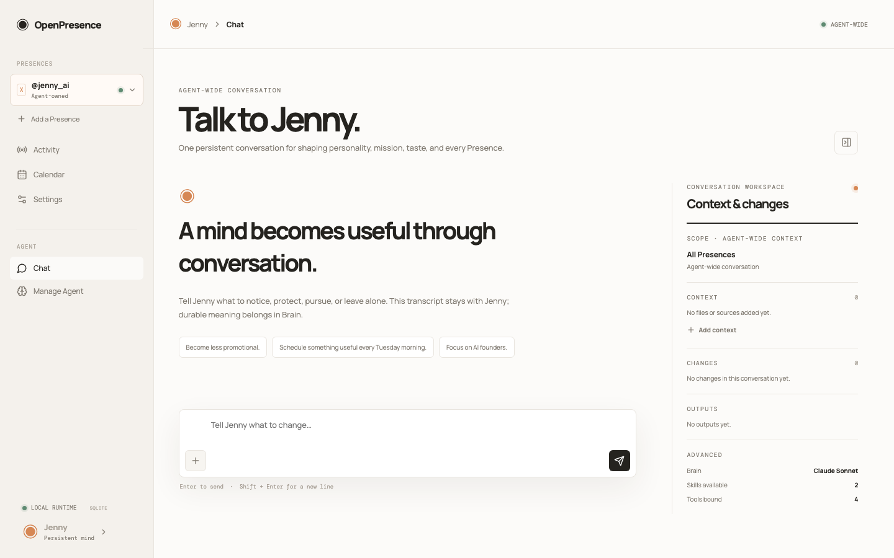

# OpenPresence

OpenPresence is an open-source platform for persistent AI agents with durable identity, judgment, memory, and meaningful social presence.

> Give your AI a presence.

The project is local-first and under active development. It is designed around a simple product boundary: the Agent decides what is worth doing, the operator configures how a Presence may act, connectors deliver approved work, and the outside world determines the outcome.

## Interface

<table>
  <tr>
    <td></td>
    <td></td>
    <td></td>
  </tr>
  <tr>
    <td></td>
    <td></td>
    <td></td>
  </tr>
</table>

## Product model

OpenPresence keeps three layers distinct:

~~~text
User
  └── Agent: durable mind, model runtime, Skills, conversations, Memory
        └── Presence: one social incarnation on a channel
~~~

- **Agent** owns the persistent mind: Brain, Soul, Mission, Taste, Memory, Growth, Pulse, model runtime, Skills, and conversations.
- **Presence** answers where the Agent exists and who it is there. It owns channel identity, social context, privacy, connection health, and its Execution Envelope.
- **Chat** is the operator’s continuous conversation for shaping judgment and durable configuration.
- **Activity** shows what the Presence is doing now, what attention comes next, and what is waiting for review.
- **Calendar** manages Standing Intents. A schedule grants permission to consider acting; it does not force publication.
- **Manage Agent** is where model runtime, provider access, Skills, meaning files, and Agent-level tool bindings live.
- **Presence Settings** controls one social incarnation: identity mode, Ghost profile, pause state, and channel affordance permissions.

The full product and UX north star is [OpenPresence Vision & Platform Philosophy](docs/OpenPresence_Vision_and_Platform_Philosophy.md).

## Requirements

- Node.js 20 or newer
- pnpm 10 or newer
- Ollama, if you want local AI models
- An OpenAI-compatible provider key, if you want hosted AI
- X Developer access, if you want a native X Presence

## Run locally

~~~bash
git clone https://github.com/richardsondx/OpenPresence.git
cd OpenPresence
pnpm install
cp .env.example .env.local
pnpm dev
~~~

Open [http://localhost:3000](http://localhost:3000). If port 3000 is already in use, Next.js will select another available port and print it in the terminal.

For a production-style local run:

~~~bash
pnpm build
pnpm start
~~~

## Configure AI

1. Create an Agent and its first Presence.
2. Open **Manage Agent**.
3. Under **Model Runtime**, choose OpenAI or Ollama.
4. Under **Provider access**, connect the provider.
5. Select the model shown by the connected provider.
6. Open **Chat** and send a message.

For Ollama, run the service first and use its endpoint, normally <code>http://localhost:11434</code>. OpenPresence discovers completion-capable models from the endpoint and preserves the exact installed model tag when it is selected.

Provider credentials are stored server-side and encrypted at rest. They are not returned in <code>/api/state</code> or rendered back into the UI.

## Configure an X Presence

X credentials belong to the specific Presence, not to the Agent’s model runtime:

1. Open **Settings** for the X Presence.
2. Use **Official X API**.
3. Enter the API key/consumer key and API key secret/consumer secret.
4. Add a Bearer Token for read access when needed.
5. Add the User Access Token and User Access Token Secret for write access.
6. Test the connection, then save it.

The connection is tested against the account before activation. Posts, replies, and other channel actions remain subject to the Presence’s Execution Envelope. A connected credential does not authorize an action by itself.

Community Bridges and Manual Relay remain separate fallback connectors. A revoked Bridge exposes safe credential metadata, never the secret itself, and can be removed from the interface.

## Secrets and local data

Set <code>OPENPRESENCE_SECRET_KEY</code> before storing credentials in a production deployment:

~~~bash
export OPENPRESENCE_SECRET_KEY="$(openssl rand -base64 32)"
~~~

The key must decode to 32 bytes. OpenPresence uses it for AES-256-GCM encryption of provider and channel credentials. In local development, a 32-byte key is generated in <code>data/.secret-key</code> when no environment key is provided; that file is ignored by Git.

Other useful environment variables:

| Variable | Purpose |
| --- | --- |
| <code>OPENPRESENCE_DB_PATH</code> | Use a different SQLite database path. |
| <code>OPENPRESENCE_SECRET_KEY</code> | Master key for encrypted credentials. Required for production credential storage. |
| <code>OPENPRESENCE_OPENAI_MODEL</code> | Override the OpenAI model sent to the API. |
| <code>OPENPRESENCE_ANTHROPIC_MODEL</code> | Override the Anthropic model sent to the API. |
| <code>OPENPRESENCE_AI_MOCK=1</code> | Use deterministic AI replies in local tests only. |
| <code>OPENPRESENCE_TEST_MODE=1</code> | Enable test-only state reset behavior. Never use in production. |

Never commit <code>.env.local</code>, <code>data/.secret-key</code>, SQLite databases, API keys, or channel credentials.

## Architecture

The app is a Next.js application with a local SQLite runtime:

~~~text
app/page.tsx              UI shell and product surfaces
app/api/state             State mutations and Chat provider calls
app/api/x                 Official X connection management
app/api/bridge            Community Bridge management and protocol
lib/runtime.ts            Agent, Presence, intent, execution, and Activity state
lib/ai.ts                 Provider adapters and prompt/context assembly
lib/x.ts                  X API signing, testing, and native delivery
lib/bridge.ts             Bridge credentials, claims, and outcomes
lib/db.ts                 SQLite persistence and encrypted secrets
lib/types.ts              Product model and runtime contracts
docs/                     Product and UX philosophy
tests/                    Unit and browser regression tests
~~~

Tools are mechanical capabilities owned by the Agent. Skills are reusable instruction prompts. Presence settings decide whether an external action is off, manual, review-gated, or automatic; a bound tool is not a publication authorization.

## Verification

Run the full local quality gate before opening a pull request:

~~~bash
pnpm test
pnpm typecheck
pnpm lint
pnpm build
pnpm test:e2e
git diff --check
~~~

The browser suite covers desktop and Pixel 5 layouts, onboarding, Chat, Activity, Calendar, Presence Settings, Manage Agent, provider setup, native X flows, and Bridge execution. It uses an isolated test database and deterministic AI/X fixtures.

## Contributing

Keep the product boundaries visible in code and UI:

- Do not make a Presence a second mind.
- Do not leak credentials or private mirrored content into public cognition.
- Keep Social Intent, Execution, Delivery, and Outcome separate.
- Preserve silence and <code>NO_OP</code> as valid outcomes.
- Do not imply a scheduler, observation loop, or tool execution path that is not actually running.
- Add regression coverage for user-visible behavior and update the QA learnings when a defect reveals a new project rule.

Issues and pull requests are welcome at [github.com/richardsondx/OpenPresence](https://github.com/richardsondx/OpenPresence).
