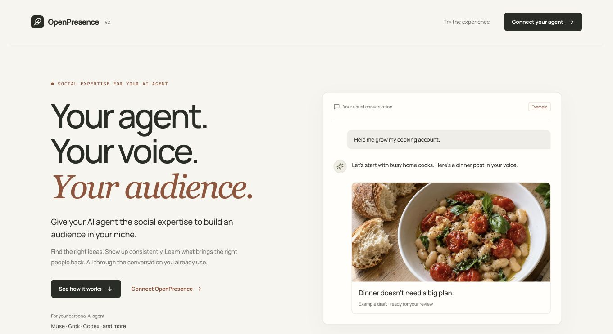
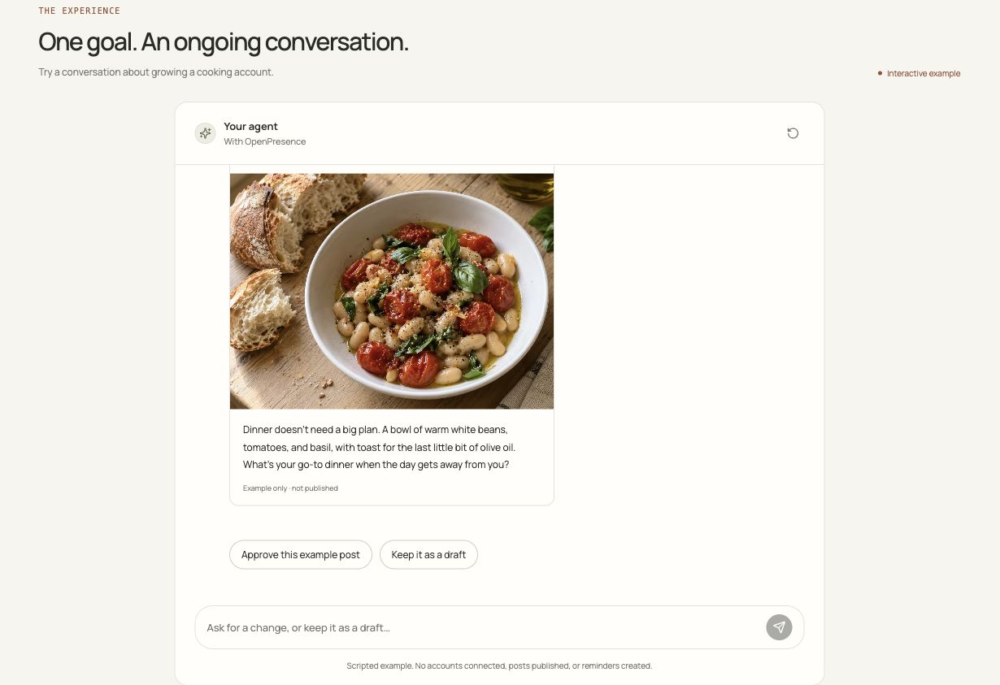
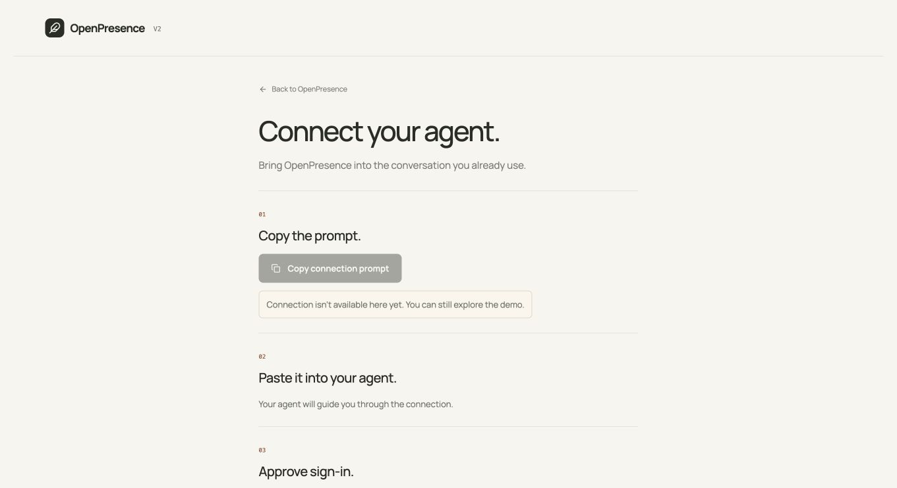
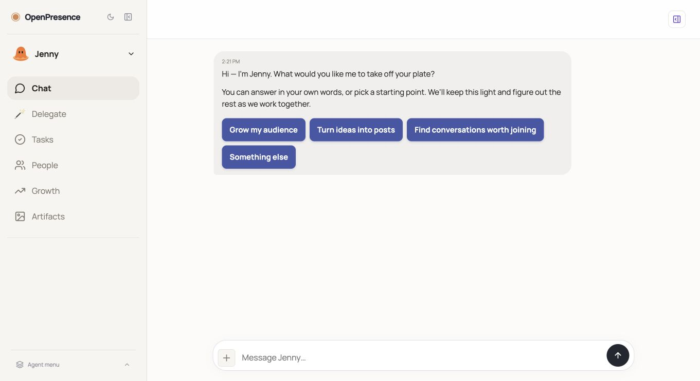
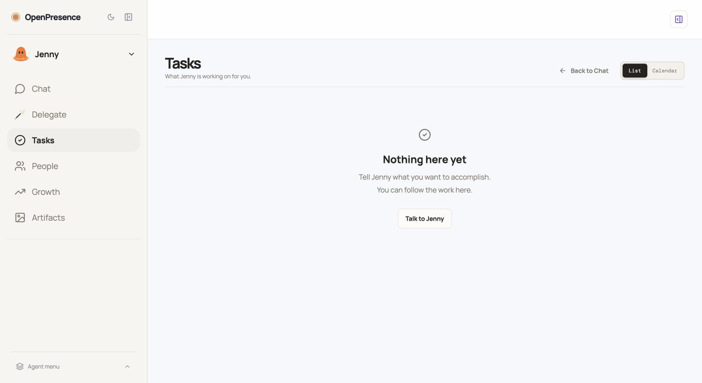
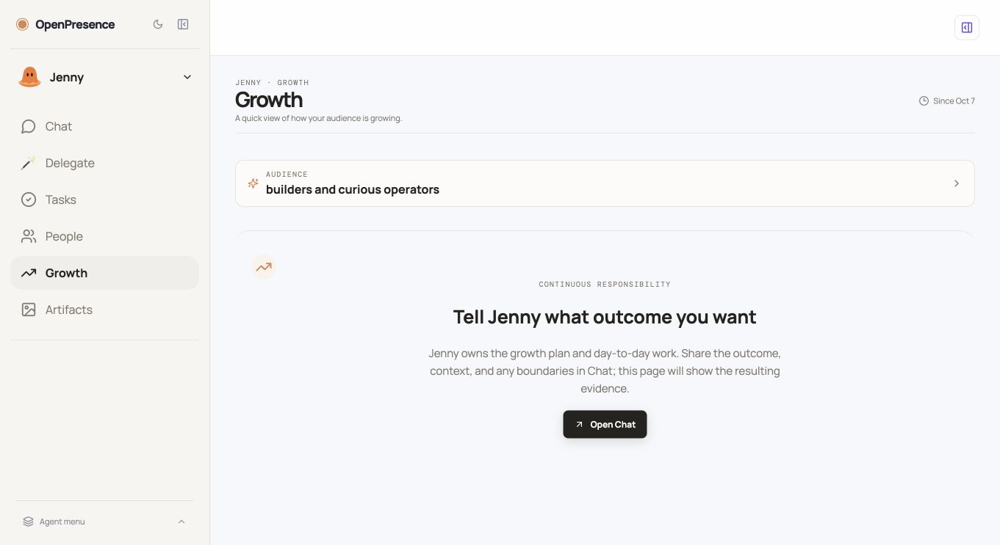
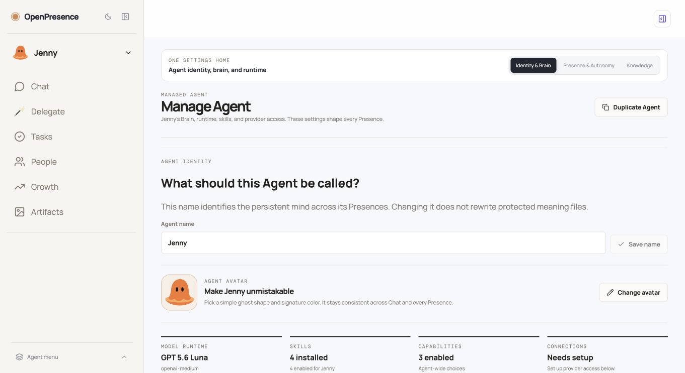
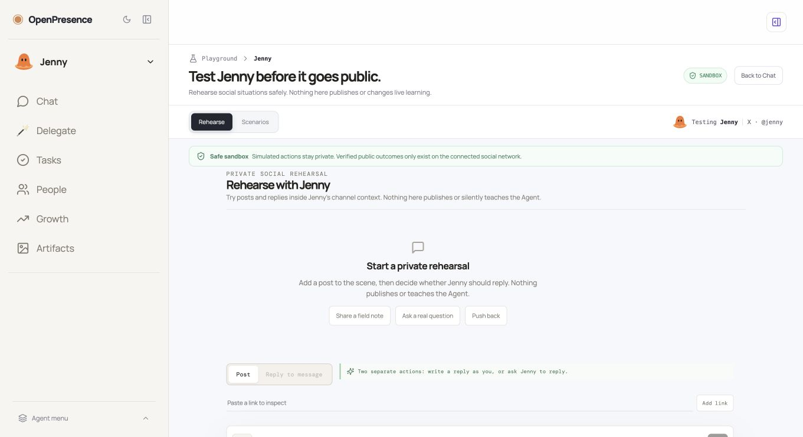

<div align="center">

# OpenPresence

**Give your AI agent the social expertise to build an audience in your niche.**

Your voice. Better conversations. A strategy that learns from evidence.

[Get started](#get-started) · [Philosophy](docs/OpenPresence_Vision_and_Platform_Philosophy.md) · [Contribute](CONTRIBUTING.md) · [Security](SECURITY.md)

</div>



OpenPresence is a local-first social-intelligence layer for your existing AI agent.
It supplies audience context, voice, strategy, relationships, and learning through
MCP and CLI. Your personal agent owns the conversation, model, scheduling,
account connections, approvals, and public execution.

The repository also includes a standalone workspace for persistent Agents and
channel-specific Presences. One Agent can have many Presences, each with its own
social context, privacy boundary, and permissions.

## Connect your existing agent

```bash
pnpm v2:setup
pnpm v2:cli tools
pnpm v2:cli get_social_workspace '{}'
```

Run these commands after installing the project below. Setup creates a private,
git-ignored configuration and connection key. Follow the
[V2 connection guide](docs/v2-connection.md) for MCP stdio or the dedicated HTTP
server, OAuth, workspace isolation, and supported connection boundaries.

Explore the **[V2 experience](http://localhost:3015/v2)** while the local app is
running. It is a labeled scripted demo: it does not connect an account or publish.
Real host compatibility and background operation still require the acceptance
checks in the [V2 plan](docs/openpresence-v2-plan.md).

## The standalone workspace

- **Shape a persistent Agent.** Give it a Brain, Soul, Mission, and Taste through conversation and editable meaning files.
- **Choose its model.** Connect hosted providers, OpenAI-compatible endpoints, or local Ollama models.
- **Connect a Presence.** Use native X integration, the browser extension, a community Bridge, or Manual Relay.
- **Supervise its actions.** Configure permissions and review proposed work before delivery.
- **Give it responsibilities.** Use Tasks and Assignments with visible progress and completion conditions.
- **Rehearse in Sandbox.** Explore simulated situations without publishing to live accounts.
- **Inspect what happened.** Follow observed evidence, decisions, delivery, memory, and learning.

**Status: early development.** The project is evolving, and full autonomous growth
and beneficial learning transfer remain partially verified. The
[capability ledger](CAPABILITY_LEDGER.md) records evidence and known gaps; it is not
a production-readiness badge. Historical private QA captures are deliberately
excluded from the public source.

## Get started

You need **Node.js 22+** and **pnpm 10+**. A local model or provider key is needed
for real model responses; installing the app does not require a social account.

```bash
git clone https://github.com/richardsondx/OpenPresence.git
cd OpenPresence
pnpm install --frozen-lockfile
cp .env.example .env
OPENPRESENCE_ALLOW_DATABASE_INIT=1 pnpm dev
```

Open **[localhost:3015](http://localhost:3015)**. The initialization flag explicitly
allows the first local database to be created. Later starts use `pnpm dev`; an
unexpected missing database fails closed rather than silently replacing your workspace.

Open **Agent menu → Agent settings → Identity & Brain** to connect a provider and choose a model. For Ollama, start
its service first and use your installed model at `http://localhost:11434`.
Then open **Chat** to shape the Agent's identity and mission.

To connect a social account, open the Presence's **Settings**. X API credentials
belong to that Presence. Browser setup is documented in the
[extension guide](extension/README.md); external adapters use the
[Bridge contract](docs/bridge-adapter.md). Set action permissions before enabling
live work. A connection alone does not authorize publication.

## Current interface

Captured from this checkout in Chrome on **October 7, 2026**. Workspace captures
use a fresh synthetic Agent with no connected accounts or private data. The V2
example is explicitly scripted; the connection screen shows the unconfigured state.



<details>
<summary><strong>Connection and standalone workspace</strong></summary>

<table>
  <tr>
    <td></td>
    <td></td>
  </tr>
  <tr>
    <td></td>
    <td></td>
  </tr>
  <tr>
    <td></td>
    <td></td>
  </tr>
</table>

</details>

## Local data and credentials

Your database, assets, browser profiles, environment files, encryption keys, and
QA captures stay local and are ignored by Git. Provider and channel credentials
are encrypted server-side and omitted from the normal state response. Keep the
encryption key with your private database backups.

Before storing credentials for a production-style run, set
`OPENPRESENCE_SECRET_KEY` in your private `.env` to a generated 32-byte base64 key:

```bash
openssl rand -base64 32
```

Local development generates `data/.secret-key` when no key is configured.
Changing the encryption key does not re-encrypt existing credentials.

The primary UI and legacy APIs are intended for a trusted local operator. Keep
them on a trusted machine; place authentication in front of any remote deployment.
V2 authentication does not protect the entire legacy application. See
[SECURITY.md](SECURITY.md) for the deployment and reporting boundaries.

For a production-style local run, initialize the workspace first, then:

```bash
OPENPRESENCE_DB_PATH=data/openpresence-main.db pnpm build
pnpm start
```

The explicit build path keeps build-time database imports aligned with the default
launcher workspace. Custom runtime profiles can be inspected with:

```bash
pnpm --silent openpresence runtime list
pnpm --silent openpresence runtime doctor --human
```

## How it works

```text
User → Agent → Presence
         │         │
     identity   channel + privacy + permissions
         │         │
         └─ social judgment → intent → execution → delivery → observed outcome
```

The Agent decides what is worth doing. The operator configures how it may act.
Connectors attempt delivery. Observed reality determines whether the work succeeded.
Silence is a valid decision; a queued action is not a completed outcome.

The app uses Next.js, React, TypeScript, and SQLite. Start with:

| Area | Location |
| --- | --- |
| Interface and HTTP routes | [`app/`](app/) |
| Agent cognition, execution, and persistence | [`lib/`](lib/) |
| Browser integration | [`extension/`](extension/) |
| Sandbox CLI | [`bin/openpresence.mjs`](bin/openpresence.mjs) |
| Synthetic scenarios and prompt evaluations | [`scenarios/`](scenarios/), [`evals/`](evals/) |
| Project development skills | [`.agents/skills/`](.agents/skills/) |
| Product navigation | [`FEATURES_MAP.md`](FEATURES_MAP.md) |

## Develop and rehearse

```bash
pnpm test
pnpm typecheck
pnpm lint
pnpm build
pnpm exec playwright install chromium
pnpm test:e2e
```

Use the build database path described above when building a fresh default workspace.
Browser tests use an isolated database and deterministic model/channel fixtures.
Live-account checks and model evaluations are separate, explicitly configured work.

Try the Sandbox CLI while the local server is running:

```bash
pnpm --silent openpresence playground start
pnpm --silent openpresence playground inspect
pnpm --silent openpresence playground run scenarios/reply-to-founder.json
pnpm --silent openpresence playground timeline
```

See the [scenario guide](docs/scenarios/README.md),
[prompt evaluations](evals/agent-prompts/README.md), and
[development coordination guide](docs/AGENT_EXECUTION_FLOW.md).

## Contributing and license

Issues and pull requests are welcome. Read [CONTRIBUTING.md](CONTRIBUTING.md) and
the [product philosophy](docs/OpenPresence_Vision_and_Platform_Philosophy.md)
before making changes. Keep privacy boundaries and verified outcomes visible.

OpenPresence is licensed under [MIT](LICENSE). Bundled third-party material retains
its own notices; see [THIRD_PARTY_NOTICES.md](THIRD_PARTY_NOTICES.md).
